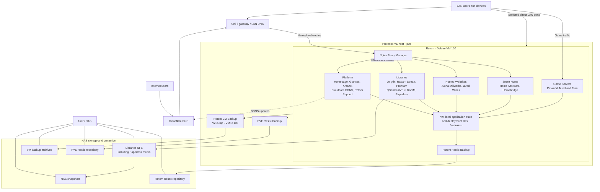

# Rotom Architecture Diagram

This overview shows the documented relationships between Rotom, its services, storage, and backup systems. It is supplementary orientation, not an operational procedure. The [server inventory](../runbook/01-Rotom-Server-Inventory.md) and linked numbered runbooks are authoritative. Evidence is drawn from the documented state as of 2026-10-17; this diagram is not a new live audit.

Rotom Restic protects selected guest-local data and excludes `/mnt`; the VM backup protects the VM disk, not external NFS data. NAS snapshots protect NAS-resident Libraries data. These layers are complementary; see [backup and restore](../runbook/05-Backup-and-Restore.md). The NAS also has empty service-boundary mounts for Game Servers, Smart Home, and Hosted Websites; their application state remains VM-local. Access depends on DNS, gateway forwarding, proxy rules, and application controls; a diagrammed route alone does not establish public exposure. See [network and domains](../runbook/03-Network-and-Domains.md) and the [architecture system overview](Rotom-Architecture-System.md) for details and evidence qualifications.
