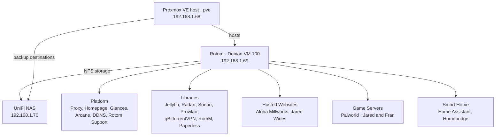
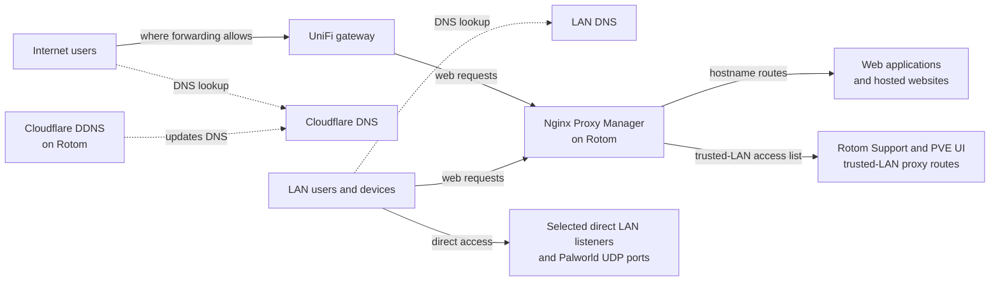
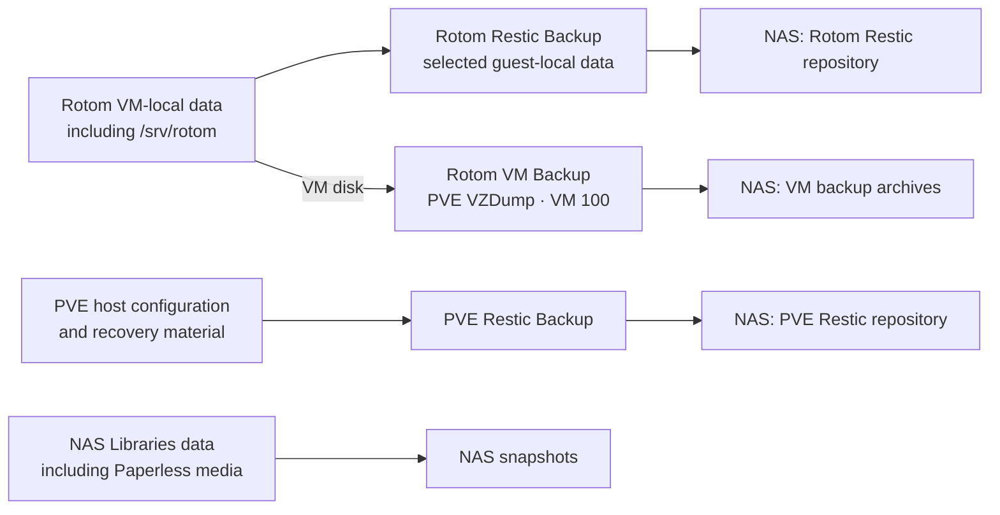

# Rotom Architecture Diagram

Rotom is the Debian application VM running on the Proxmox host `pve`. Its applications use both VM-local storage and a separate UniFi NAS. These diagrams explain the documented architecture as of 2026-10-17; they are an orientation, not an operational procedure or a new live audit. The [server inventory](../runbook/01-Rotom-Server-Inventory.md) and numbered runbooks own current facts and procedures.

## 1. Systems and services

The host runs Rotom as VM 100. Docker Compose organizes its applications into five service domains. The NAS is a separate system on the LAN.

## 2. How requests reach services

DNS answers a name lookup; it does not carry the application request. The solid arrows show request paths, while dotted arrows show DNS lookups or updates.

A DNS answer or proxy route alone does not establish public access: gateway forwarding, NPM rules, and application controls also matter. Some LAN services have direct listeners; Palworld uses UDP rather than NPM. See [network and domains](../runbook/03-Network-and-Domains.md) for exact routes and boundaries.

## 3. Data and protection

Each arrow describes a different protection path. The NAS holds both application data and backup destinations; these are separate roles.

- **Rotom Restic** protects selected guest-local paths; it excludes `/mnt` and does not back up the external Libraries data.
- **Rotom VM Backup** protects the VM disk, not the contents of external NFS mounts.
- **NAS snapshots** protect NAS-resident Libraries data. Paperless media and its VM-local database need compatible recovery points.
- **PVE Restic** protects selected PVE host configuration and recovery material separately from the Rotom VM.

Game Servers, Smart Home, and Hosted Websites also have empty NAS service-boundary mounts; their current application state remains VM-local. NAS snapshot protection was owner-confirmed, while exact NAS control-plane settings were not exported during the documented review. See [backup and restore](../runbook/05-Backup-and-Restore.md), [NAS and storage](../runbook/04-NAS-and-Storage.md), and the detailed [architecture system overview](Rotom-Architecture-System.md).
