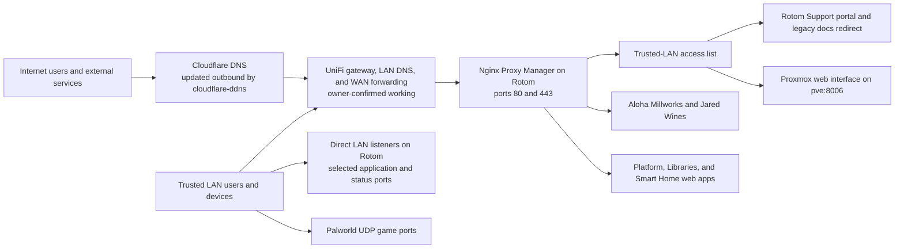
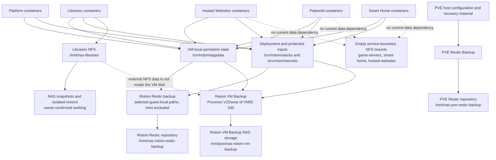

# Rotom Architecture Overview

**Artifact class:** Supplementary repository architecture document; not a Rotom Support or Available Sources member
**Document role:** Newcomer-friendly map of Rotom's services, access paths, storage, and data protection
**Evidence baseline:** Rotom Support plus read-only live inspection on 2026-10-17
**Documentation updated:** 2026-10-17
**RS index:** [01 - Rotom Server Inventory](../runbook/01-Rotom-Server-Inventory.md)

This guide explains the system at a high level. It is not a replacement for the numbered Rotom Support (RS) documents, which remain authoritative for configuration, troubleshooting, and recovery.

## Reading the status labels

- **Verified live** means the item was observed on Rotom on 2026-10-17.
- **Owner-confirmed** means Jared confirmed the external system or policy is working, although this review did not export its authenticated configuration.
- **Documented, not observed** means current RS describes the item, but this review did not inspect the external system that owns it.
- **Active mismatch** means live state and the current RS differ. The guide reports both and does not silently choose one.
- **Documented inactive** means the item is intentionally retained but not running.
- **Retired** means it must not be treated as a current service or recreated from history without new evidence and authorization.
- **Uncertain** or **inferred** identifies a conclusion that the available evidence does not fully prove.

## Overview

Rotom is a Debian 13 virtual machine, VMID `100`, hosted by the Proxmox VE server `pve`. It is the main application server for a small collection of home, media, document, website, game-server, monitoring, proxy, and administration services. Most applications run as Docker Compose projects.

Rotom's main responsibilities are:

- run and supervise the Docker applications;
- receive web requests through Nginx Proxy Manager (NPM), terminate HTTPS, and forward each hostname to the right application;
- keep VM-local application state under `/srv/rotom`;
- mount authoritative shared data and backup repositories from the NAS;
- publish the Homepage dashboard and read-only status surfaces;
- create scheduled Restic backups of selected VM-local data; and
- participate in whole-VM and PVE-host backup workflows owned by the Proxmox host.

The three core systems use reserved LAN addresses:

| System | Address | Role | Verification status |
|---|---:|---|---|
| `pve` | `192.168.1.68` | Proxmox hypervisor, whole-VM backups, and PVE configuration backup | Backup schedules/results **verified through read-only status API**; remaining host configuration **owner-confirmed** working |
| `rotom` | `192.168.1.69` | Debian VM and Docker application host | **Verified live** |
| UniFi UNAS 2 | `192.168.1.70` | NFS storage for Libraries data and backup destinations | Exact Rotom NFS sources **verified live**; NAS control plane and snapshot protection **owner-confirmed** working |

Important external dependencies are the UniFi router and LAN DNS/DHCP services, Cloudflare DNS and the outbound Cloudflare DDNS container, NPM certificates, the NAS, Proxmox, and the Internet services used by individual applications. Home Assistant also depends on passed-through hardware such as the ConBee II Zigbee adapter; qBittorrentVPN depends on its configured WireGuard VPN provider. Exact Cloudflare DNS records were verified through its API and independent resolution. Jared confirmed the router/WAN, PVE, NAS control plane, and NAS snapshot protection are working and waived further authenticated inspection; their exact control-plane settings were not exported into this review.

## How requests reach Rotom

In plain language: a named HTTPS request normally reaches NPM first. NPM chooses an upstream from the hostname and forwards the request. The support portal, its legacy redirect, and the PVE route have an NPM trusted-LAN boundary. Other NPM routes have no NPM access list; that fact alone does **not** prove Internet exposure because DNS and router forwarding are separate layers. Some applications also listen directly on the trusted LAN, and Palworld uses direct UDP ports rather than an HTTP hostname.

### Terms used here

- A **reverse proxy** is a front door that accepts a web request and sends it to the correct internal application.
- An **upstream** is the application address and port behind that proxy.
- **TLS termination** means NPM presents the HTTPS certificate, then talks to the internal application.
- An **access list** is an NPM rule that allows or denies client networks.
- **Loopback-only** means a port listens only on `127.0.0.1`, so another machine cannot reach it directly; NPM on the same VM can.
- A **Compose project** is one or more related Docker containers managed from one `compose.yaml` file.
- An **automount** is a configured filesystem that connects when first used instead of remaining mounted all the time.

## Domains and access

The following table combines current RS routes with the live NPM database, generated NPM configuration for the support routes, local HTTPS probes, and current listeners. An HTTP `200`, `301`, or `302` in the notes is an observed application response, not proof that the route is reachable from the public Internet.

### Current routes

| Domain or subdomain | Purpose and service reached | Request path and access boundary | Status on 2026-10-17 |
|---|---|---|---|
| `rotom.casa` | Homepage dashboard | DNS/router -> NPM -> Homepage at `127.0.0.1:3001`; Homepage expects this host name. Direct LAN port `3001` also exists. | **Verified live**, local HTTPS `200` |
| `arcane.rotom.casa` | Arcane Docker management UI | NPM -> loopback port `3552`; direct LAN port `3552` also exists. No NPM access list is assigned. | **Verified live**, `200` |
| `home-assistant.rotom.casa` | Home Assistant | NPM -> `127.0.0.1:8123`; Home Assistant uses host networking and also listens on the LAN. | **Verified live**, `200` |
| `homebridge.rotom.casa` | Homebridge | NPM -> `127.0.0.1:8581`; Homebridge uses host networking and discovery-related host ports. | **Verified live**, `200` |
| `jellyfin.rotom.casa` | Jellyfin media server | NPM -> `127.0.0.1:8096`; direct LAN port `8096` also exists. | **Verified live**, `302` |
| `nginx.rotom.casa` | NPM administration UI | NPM -> `127.0.0.1:81`; port `81` also listens on the LAN. No NPM access list is assigned. | **Verified live**, `200` |
| `paperless.rotom.casa` | Paperless document management | NPM -> loopback-only port `8000`. | **Verified live**, `302` |
| `prowlarr.rotom.casa` | Prowlarr indexer manager | NPM -> `127.0.0.1:9696`; direct LAN port `9696` also exists. | **Verified live**, `302` |
| `qBittorrent.rotom.casa` | qBittorrentVPN web UI | NPM -> loopback-only port `8080`. DNS names are case-insensitive even though this NPM row contains a capital `B`. | **Verified live**, `200` |
| `radarr.rotom.casa` | Radarr movie management | NPM -> `127.0.0.1:7878`; direct LAN port `7878` also exists. | **Verified live**, `302` |
| `romm.rotom.casa` | RomM game-library UI | NPM -> loopback-only port `8081`. | **Verified live**, `200` |
| `sonarr.rotom.casa` | Sonarr TV management | NPM -> `127.0.0.1:8989`; direct LAN port `8989` also exists. | **Verified live**, `302` |
| `support.rotom.casa` | Private Rotom Support portal | NPM host `27` -> loopback-only `127.0.0.1:8082`; generated configuration allows loopback and `192.168.1.0/24`, then denies all others. | **Verified live**, `200` |
| `docs.rotom.casa` | Legacy private documentation name | NPM host `22` uses the same trusted-LAN boundary and returns a permanent redirect to `https://support.rotom.casa/runbook/`, preserving the requested path/query in its generated rule. | **Verified live**, `301` |
| `pve.rotom.casa` | Proxmox web interface | DNS/router -> NPM on Rotom -> HTTPS `192.168.1.68:8006`; trusted-LAN NPM access list. The upstream is an external host, not a Rotom container. | Route **verified live**, `200`; backup status APIs verified, but host configuration itself **not freshly observed** |
| `jaredwines.com` | Jared Wines website | Public/LAN DNS and router -> NPM -> loopback-only `127.0.0.1:7777` -> website container. RS records intentional public access. | **Verified live**, `200` |
| `alohamillworks.com` | Aloha Millworks website | Public/LAN DNS and router -> NPM -> `127.0.0.1:7778` -> website container. | **Verified live**, local and external HTTPS `200`; canonical RS corrected to match the live route |
| `*.rotom.casa` | Wildcard DNS behavior, not an application by itself | Cloudflare unproxied wildcard CNAME -> `rotom.casa`; a working service still requires an NPM route, listener, and applicable access policy. | **Verified active** through Cloudflare API and public DNS; LAN apex has a separate local override |

### Historical, deleted, or otherwise non-current names

These names remain visible either as deleted NPM database rows or in preserved RS history. They are included so a newcomer does not mistake DNS resolution or an old reference for a supported service.

| Name | Former or uncertain purpose | Observed/documented state |
|---|---|---|
| `gamarr.rotom.casa` | Former Gamarr service | **Retired**; NPM row is deleted and former port `6767` is not a current documented listener |
| `syncthing.rotom.casa` | Former Syncthing service | **Retired**; NPM row is deleted |
| `uptime.rotom.casa` | Former Uptime Kuma service | **Retired**; NPM row is deleted |
| `romm-upload.rotom.casa` | Former browser upload bridge | **Retired**; NPM row is disabled and deleted |
| `hb.smart-hub.local` | Legacy Homebridge name on an old address | **Retired**; NPM row is deleted |
| `nginx.smart-hub.local` | Legacy NPM name on an old address | **Retired**; NPM row is deleted |
| `portainer.smart-hub.local` | Legacy Portainer name | **Retired**; NPM row is deleted and Portainer is not a current supported container |
| `olivetin.smart-hub.xyz` | Legacy OliveTin name | **Retired**; NPM row is deleted and OliveTin is not a current supported container |
| `paltools.smart-hub.xyz` | Legacy PalTools name | **Retired**; NPM row is deleted |
| `palworld.smart-hub.xyz` | Legacy Palworld web/proxy name | **Retired**; NPM row is deleted. Current Palworld access is by direct UDP ports, not this route. |
| `homepage.rotom.casa` | Historical possible Homepage name | **Uncertain / not current:** preserved history says its explicit DNS record was never verified; no current NPM row was observed. Current Homepage name is `rotom.casa`. |

## Docker containers

Live inspection found 24 container objects: 23 running and one intentionally stopped rollback container. The 23 running containers belong to 18 active Compose definitions. Each project normally has a private Docker network; NPM, Home Assistant, and Homebridge intentionally use host networking. Glances is reachable only by Homepage on their shared private network.

The main path convention is:

- `/srv/rotom/stacks/<domain>/<project>/compose.yaml` for declarative deployment files;
- `/srv/rotom/appdata/<domain>/<project>/` for VM-local mutable state;
- `/srv/rotom/secrets/<domain>/` for protected inputs; and
- `/mnt/nas-*` for NAS-backed data or backup repositories.

### Platform

| Container | What it does | Important connections and storage | Status |
|---|---|---|---|
| `nginx-proxy-manager` | HTTPS front door and hostname router | Host network; VM-local proxy database and certificates under `/srv/rotom/appdata/platform/nginx-proxy-manager`; read-only access to the NAS game library for a controlled route/use documented by the deployment | **Verified live** |
| `homepage` | Main dashboard | Port `3001`; VM-local configuration; read-only Docker socket; reaches Glances by service name on `homepage_default` | **Verified live**, healthy |
| `glances` | System metrics for Homepage | No host listener; read-only host root and Docker socket; shares `homepage_default` with Homepage | **Verified live** |
| `arcane` | Docker/Compose management | Port `3552`; VM-local state; Docker socket; writable Platform stack definitions and read-only Platform secrets. Accepted policy: update daily at midnight and heal every five minutes, both with empty exclusions; heal limit five restarts per 30 minutes; pruning off. | **Verified live**, healthy; policy accepted by owner |
| `cloudflare-ddns` | Updates Cloudflare DNS from Rotom | Outbound-only; reads a protected token file from `/srv/rotom/secrets/platform`; explicit DNS `192.168.1.1`; no inbound listener | **Verified live** after resolver correction; reports apex record current |
| `mkdocs-rr` | Serves the generated Rotom Support site | Loopback-only port `8082`; read-only generated site under `/srv/rotom/appdata/platform/mkdocs-rr/site` | **Verified live** |
| `rotom-docs` | Retained previous documentation stack for rollback | Separate retained Compose/appdata and `rotom-docs_default` network; not the active portal | **Documented inactive**, exited normally |

### Libraries

| Container | What it does | Important connections and storage | Status |
|---|---|---|---|
| `jellyfin` | Streams the media library | VM-local configuration; read-only `/mnt/nas-libraries/library`; LAN port `8096` | **Verified live** |
| `radarr` | Organizes movies | VM-local configuration; read/write Libraries mount at `/media`; torrent subpath additionally mounted read-only; LAN port `7878` | **Verified live** |
| `sonarr` | Organizes TV shows | VM-local configuration; read/write Libraries mount at `/media`; torrent subpath additionally mounted read-only; LAN port `8989` | **Verified live** |
| `prowlarr` | Supplies indexers to Radarr/Sonarr and related clients | VM-local configuration only; no NAS bind; LAN port `9696` | **Verified live** |
| `qbittorrentvpn` | Downloads through WireGuard/VPN | VM-local configuration; read/write `/mnt/nas-libraries/torrents`; read-only NAS readiness sentinel; loopback-only UI `8080` | **Verified live** |
| `romm` | RomM web application and game-library reader | VM-local data/assets/config/resources/backup; read-only `/mnt/nas-libraries/library/games`; talks to `romm-db` and `romm-valkey` on `romm_default`; loopback-only UI `8081` | **Verified live** |
| `romm-db` | RomM MariaDB database | VM-local database under `/srv/rotom/appdata/libraries/romm/database`; private `romm_default` network | **Verified live**, healthy |
| `romm-valkey` | RomM cache/queue | VM-local Valkey data; private `romm_default` network | **Verified live** |
| `paperless` | Paperless document application | VM-local application/search/consume/export state; authoritative media at `/mnt/nas-libraries/paperless`; talks to database and broker; loopback-only UI `8000` | **Verified live**, healthy |
| `paperless-db` | Paperless PostgreSQL database | VM-local database under `/srv/rotom/appdata/libraries/paperless/database`; private `paperless_default` network | **Verified live** |
| `paperless-broker` | Paperless Valkey job broker | VM-local broker data; private `paperless_default` network | **Verified live** |

### Hosted Websites

| Container | What it does | Important connections and storage | Status |
|---|---|---|---|
| `alohamillworks.com` | Serves the Aloha Millworks PHP/Apache site | Website content is VM-local and mounted read-only into the container; host port `7778`; no dependency on the empty Hosted Websites NAS boundary | **Verified live** |
| `jaredwines.com` | Serves the Jared Wines static Nginx site | Website content is VM-local and mounted read-only; loopback-only port `7777`; no dependency on the empty Hosted Websites NAS boundary | **Verified live** |

### Game Servers

| Container | What it does | Important connections and storage | Status |
|---|---|---|---|
| `palworld-server-jared` | Jared's Palworld server | VM-local world/server state under `/srv/rotom/appdata/game-servers/palworld-jared`; UDP `8211` and `27015`; does not use the empty Game Servers NAS boundary | **Verified live**, healthy; intended to remain running under `restart: unless-stopped` |
| `palworld-server-fran` | Fran's Palworld server | VM-local world/server state under `/srv/rotom/appdata/game-servers/palworld-fran`; UDP `8212` and `27016`; does not use the empty Game Servers NAS boundary | **Verified live**, healthy; intended to remain running under `restart: unless-stopped` |

### Smart Home

| Container | What it does | Important connections and storage | Status |
|---|---|---|---|
| `home-assistant` | Home automation platform | Host network for discovery; VM-local `/config`; host D-Bus and ConBee II passthrough; explicit router DNS; no dependency on the empty Smart Home NAS boundary | **Verified live** |
| `homebridge` | HomeKit bridge | Host network for discovery; VM-local `/homebridge`; explicit router DNS; no dependency on the empty Smart Home NAS boundary | **Verified live** |

Two Docker named volumes, `arcane-backups` and `arcane-rustic-cache`, were **verified live** as objects. They were not mounted by any running container in the inspected metadata. RS already marks their exact policy and cleanup disposition as needing authenticated Arcane review; their presence is not deletion authorization.

Services documented as retired, including Uptime Kuma, Syncthing, Gamarr, JDownloader, the ROM importer, Igir automation, and the browser upload bridge, had no current container objects in the live inventory. They are not omitted accidentally; they are retired rather than current Docker containers.

## NAS storage

### Current Rotom and PVE storage contracts

| Mount or path | What it is and what it stores | Services that depend on it | Persistence and backup relationship | Status |
|---|---|---|---|---|
| `/mnt/nas-libraries` | NFSv3 export `Libraries/.data`; authoritative media/game library, torrents, and Paperless media | Jellyfin, Radarr, Sonarr, qBittorrentVPN, RomM, Paperless, and NPM's read-only game-library use | Excluded from Rotom Restic because `/mnt` is excluded; depends on NAS-side snapshots/restore | **Verified live**, mounted read/write; automount active |
| `/mnt/nas-libraries/library` | Library subtree for media and games | Jellyfin and RomM read it; Radarr/Sonarr manage content through the broader Libraries mount; NPM has a read-only games bind | Same NAS snapshot protection as the Libraries export | **Verified live** |
| `/mnt/nas-libraries/torrents` | Download and seeding area | qBittorrentVPN writes; Radarr and Sonarr receive read-only binds in the observed container metadata | Same NAS snapshot protection as the Libraries export | **Verified live** |
| `/mnt/nas-libraries/paperless` | Authoritative Paperless media | Paperless application | NAS-side protection is required; Paperless database/config remain VM-local and must be restored consistently with media | **Verified live** |
| `/mnt/nas-rotom-restic-backup` | NFSv3 export `Rotom_Restic_Backup/.data` | Rotom Restic worker | Contains the repository that protects selected VM-local data; the repository is not itself backed up by that same job | **Verified live**, mounted read/write; automount active |
| `/mnt/nas-rotom-restic-backup/rotom-restic-backup` | Rotom's current Restic repository | `rotom-restic-backup.service` and restore workflows | Retention is 7 daily, 4 weekly, and 12 monthly for automatic snapshots | **Documented current**; parent mount and timer **verified live**, repository contents not enumerated in this review |
| `/mnt/nas-game-servers` | NFSv3 export `Game_Servers/.data`; empty service boundary | No current Palworld container dependency; Palworld state is VM-local | Not a copy of Palworld data | **Configured live**; automount waiting and not activated in this review |
| `/mnt/nas-smart-home` | NFSv3 export `Smart_Home/.data`; empty service boundary | No current Home Assistant/Homebridge dependency; state is VM-local | Not a copy of Smart Home data | **Configured live**; automount waiting and not activated in this review |
| `/mnt/nas-hosted-websites` | NFSv3 export `Hosted_Websites/.data`; empty service boundary | No current website container dependency; content is VM-local | Not a copy of website content | **Configured live**; automount waiting and not activated in this review |
| `/mnt/nas-pve-restic-backup` | PVE-side NFS location for `PVE_Restic_Backup/.data` and repository `pve-restic-backup` | PVE Restic worker | Protects selected PVE host configuration/recovery material | **Owner-confirmed** working; current job result verified through status API; exact PVE mount not observed |
| `/mnt/pve/nas-rotom-vm-backup` | Proxmox storage backed by `Rotom_VM_Backup/.data` | Proxmox job `rotom-vm-daily` and manual VZDump worker | Holds whole-VM backup archives for VMID `100` | **Owner-confirmed** working; current job result verified through status API; exact PVE mount not observed |

### Retired or historical `nas-*` paths

These guest paths are documented as absent and retired. Their absence on Rotom does **not** prove that similarly named NAS exports or data were deleted.

| Retired guest path | Former association | Current meaning |
|---|---|---|
| `/mnt/nas-media` | Former Media domain | **Retired**; do not recreate from history |
| `/mnt/nas-library` | Former singular Library domain | **Retired**; replaced by the Libraries contract |
| `/mnt/nas-downloaders` | Former downloader storage | **Retired** |
| `/mnt/nas-documents` | Former Documents storage | **Retired** |
| `/mnt/nas-filesync` | Former Filesync storage | **Retired** |
| `/mnt/nas-web` | Former Web domain | **Retired** |
| `/mnt/nas-gameserver` | Former singular Gameserver domain | **Retired**; not the current empty `/mnt/nas-game-servers` boundary |
| `/mnt/nas-smarthome` | Former Smarthome domain | **Retired**; not the current empty `/mnt/nas-smart-home` boundary |
| `/mnt/nas-customapps` | Former Customapps storage | **Retired** |
| `/mnt/nas-apps` | Former application storage | **Retired** |
| `/mnt/nas-auth` | Former authentication-related storage | **Retired** |
| `/mnt/nas-shared-drive` | Former Shared Drive guest mount | **Retired**; a historical raw image is documented below this old NAS namespace, but the guest cannot currently reach it by this path |
| `/mnt/nas-shared-drive/rotom-bare-metal/jar-25-2026-09-25/rotom-nvme-live-pre-proxmox-2026-09-25.img` | Pre-virtualization raw NVMe image | **Historical recovery evidence**; best-effort crash-consistent, not a normal current restore source, and an actual bare-metal restore has not been rehearsed |

## Service and storage relationships

In plain language: most application databases and configuration live on the VM under `/srv/rotom`, while large or authoritative Libraries payload lives on the NAS. Rotom Restic protects selected VM-local paths but deliberately excludes `/mnt`. Whole-VM backup protects the VM disk, not external NAS data. NAS snapshots are therefore essential for Libraries and Paperless media, and their recovery points must be paired thoughtfully with the corresponding VM-local databases and configuration.

The dotted arrows to the empty service-boundary shares show naming/ownership boundaries, not data dependencies. The dotted arrow from Libraries NFS to VM Backup emphasizes an exclusion: a VM archive does not contain externally mounted NAS payload.

## Data protection

Rotom uses complementary protection layers rather than one universal backup:

1. **Rotom Restic Backup** protects selected guest-local data from `/etc`, `/home`, `/root`, `/opt`, `/srv`, `/usr/local`, Docker named-volume data, and staged system information, subject to the installed include/exclude rules. It writes to the NAS repository under `/mnt/nas-rotom-restic-backup`. `/mnt` itself is excluded.
2. **Rotom VM Backup** is a Proxmox VZDump archive of VMID `100`. It protects the VM as a whole at the disk level, but not authoritative data mounted from the NAS.
3. **PVE Restic Backup** protects selected Proxmox host configuration and recovery material. It is not a full PVE disk image and does not replace the VM archive.
4. **NAS snapshots and isolated restore** protect Libraries content, torrents, game-library content, and Paperless media that guest Restic and VM Backup do not contain.
5. **Historical recovery artifacts**, including the raw pre-virtualization NVMe image, provide dated evidence and last-resort extraction options. They are not the preferred current recovery path.

The live Rotom timers for Restic backup, qBittorrent NAS guarding, and weekly maintenance were enabled and active on 2026-10-17. The Rotom Restic service ran from 03:05 to 03:06 PDT that morning and reported `Result=success` with exit status `0`, but this review did not enumerate repository snapshots or perform a restore. RS records owner-confirmed full-data-read and restore exercises without the detailed transcripts.

All primary backup destinations and NAS snapshots are at the same physical site, with substantial shared infrastructure and hardware failure domains. **No off-site backup layer is currently documented.** A green scheduled-job result proves much less than a verified, isolated restore, so recovery should always select and validate a specific recovery point before changing production data.

## Documentation-to-live comparison

The major topology matched current RS:

- 23 running containers and one stopped rollback container;
- 18 active Compose definitions plus the inactive rollback definition;
- 19 Docker networks, including the unattached retained `rotom-docs_default` network;
- two Arcane-related named volumes;
- five configured Rotom NFSv3 automount contracts;
- the documented host/loopback listener model; and
- all 17 current NPM hostnames returned their expected class of local HTTPS response.

Three NAS mounts were in the normal `active/waiting` automount state and had not been activated by this review. Libraries and Rotom Restic storage were actively mounted read/write. This is not a conflict with the five configured mount contracts.

### Remaining verification limits

- **Arcane cleanup boundary:** the update/heal policy is resolved, but its two named volumes, stale project rows, and any unreferenced images still require separate exact-object review before deletion.
- **Recovery detail:** current owner-confirmed Restic, VMA/disposable-restore, and NAS isolated-restore transcripts were not supplied to RS. An incident must verify a specific available recovery point.

Router/WAN, PVE, NAS control-plane, and NAS snapshot operation are not active discrepancies: Jared confirmed they work and asked that no further authenticated inspection be performed. Their exact control-plane exports remain intentionally outside this review.

No active-but-undocumented container, NPM hostname, or Rotom `nas-*` fstab contract was found in this review. Deleted NPM rows, the stopped rollback container, PVE-only storage, and retired guest paths are included above rather than silently omitted.

## Further reading

- [01 - Rotom Server Inventory](../runbook/01-Rotom-Server-Inventory.md) — starting point, task router, and current system summary
- [02 - Docker Services](../runbook/02-Docker-Services.md) — container and Compose inventory, service contracts, and container recovery
- [03 - Network and Domains](../runbook/03-Network-and-Domains.md) — addresses, listeners, DNS, TLS, NPM routes, and access troubleshooting
- [04 - NAS and Storage](../runbook/04-NAS-and-Storage.md) — exact NFS contracts, automount behavior, NAS dependencies, and mount recovery
- [05 - Backup and Restore](../runbook/05-Backup-and-Restore.md) — backup scope, retention, assurance levels, limitations, and ordinary restores
- [06 - Maintenance and Automation](../runbook/06-Maintenance-and-Automation.md) — timers, helpers, status services, and routine operations
- [07 - Users and Permissions](../runbook/07-Users-and-Permissions.md) — service identities, numeric ownership, ACLs, and administrative boundaries
- [08 - Rotom Directory Tree](../runbook/08-Rotom-Directory-Tree.txt) — concise path and topology reference
- [PVE and Rotom Total-Loss Recovery](../guide/PVE-and-Rotom-Total-Loss-Recovery.md) — supplementary end-to-end recovery orchestration for replacement hardware

For any change or incident, begin with the relevant numbered RS document, inspect live state, and stop if the live system differs materially from the recorded contract. Never copy credentials, tokens, private keys, cookies, certificate private material, or Restic passwords into troubleshooting notes.
